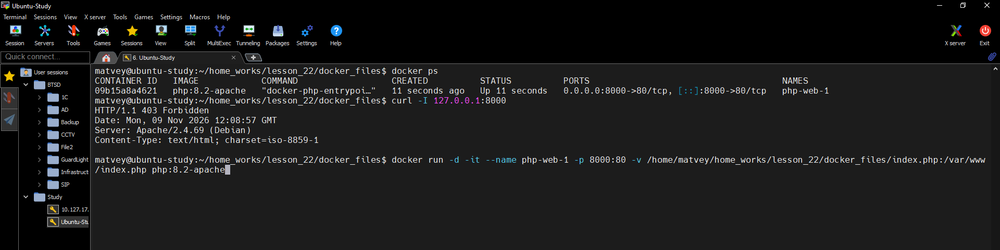
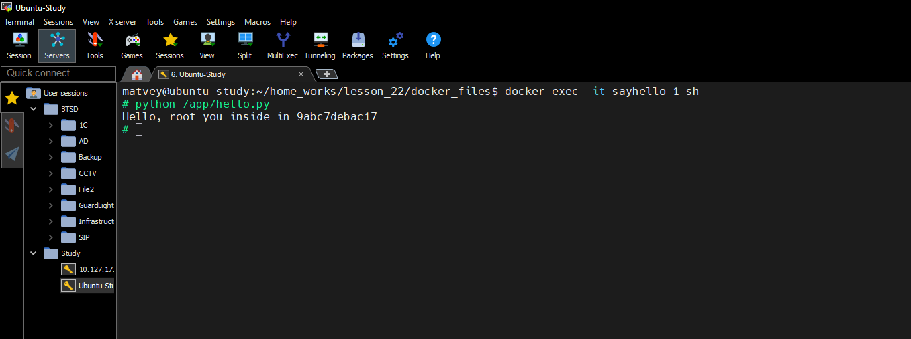
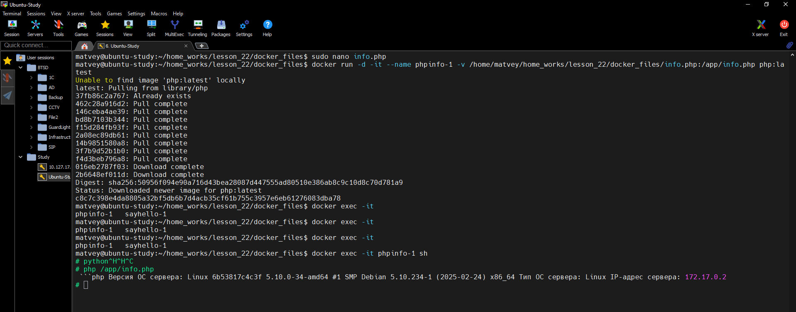
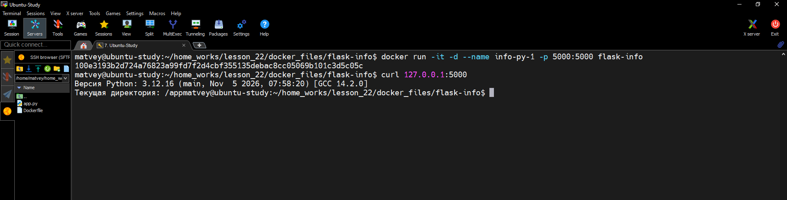
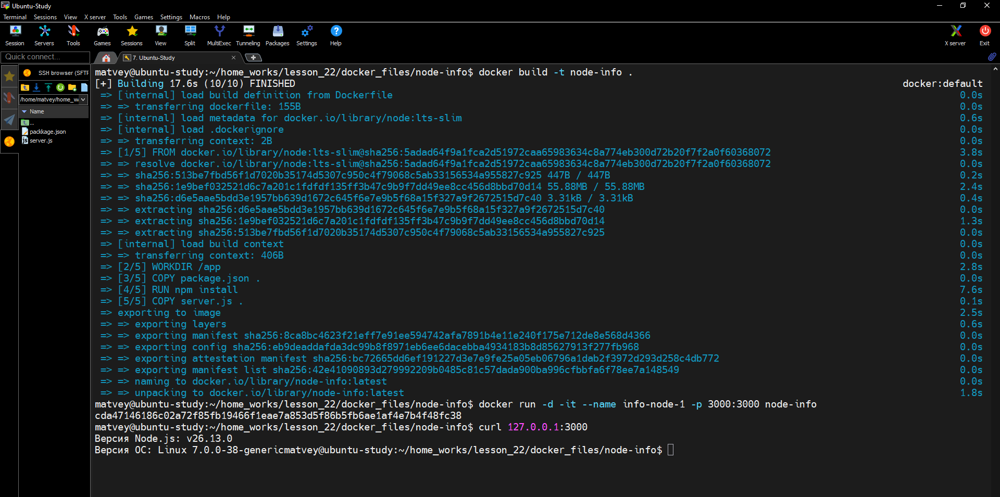

1) В домашней директории создать директорию docker_files; в директории docker_files создать файл index.php с содержимым:

 ```
<?php
phpinfo();
?>
```

Запустить контейнер из image php:8.2-apache с:

<br>- именем php-web-1</br>
<br>- маппингом портов 8000:80</br>
<br>- сопоставлением (bind mount) файла index.php на хосте с файлом /var/www/index.php в контейнере</br>
<br>- Проверить, что контейнер запустился и проверить его работу с помощью</br>
  


2) В директории docker_files создать файл hello.py с содержимым:
   
```
#!/usr/bin/python
import socket
import os
import pwd
user_name = pwd.getpwuid(os.getuid())[0]
host_name = socket.gethostname()
print(f"Hello, {user_name} you inside in {host_name}")
```
Запустить контейнер из image python:3.11 с именем sayhello-1 и сопоставлением (bind mount) файла hello.py на хосте с файлом /app/hello.py в контейнере.
Зайти в запущенный контейнер и выполнить в нем python /app/hello.py 

<br>Если вывод похож на Hello, root you inside in 1adc7f445dc9, то все ок</br>



3) В директории docker_files создать файл info.php с содержимым:

  ```
```php Версия ОС сервера: Linux 6b53817c4c3f 5.10.0-34-amd64 #1 SMP Debian 5.10.234-1 (2025-02-24) x86_64 Тип ОС сервера: Linux IP-адрес сервера: 172.17.0.2
```

Запустить контейнер из image php:latest с именем phpinfo-1 и сопоставлением (bind mount) файла info.php на хосте с файлом /app/info.php в контейнере.\
Зайти в запущенный контейнер и выполнить в нем php /app/info.php. Вывод должен быть похож на:

<br>"Версия ОС сервера: Linux 6b53817c4c3f 5.10.0-34-amd64 #1 SMP Debian 5.10.234-1 (2025-02-24) x86_64 Тип ОС сервера: Linux IP-адрес сервера: 172.17.0.2"</br>



4) В директории docker_files создать директорию flask-info, в ней файл app.py с содержимым:
 ```
from flask import Flask
import sys
import os

app = Flask(__name__)

@app.route('/')
def index():
    python_version = sys.version
    current_directory = os.getcwd()
    return f"Версия Python: {python_version}\nТекущая директория: {current_directory}"

if __name__ == '__main__':
    app.run(debug=True, host='0.0.0.0')
```

Собрать для app.py docker image; запустить из созданного image контейнер с именем info-py-1 и маппингом портов 5000:5000.

```
FROM python:3.12-slim
WORKDIR /app
RUN pip install --no-cache-dir flask
COPY app.py .
EXPOSE 5000
CMD ["python", "app.py"]
```



5) В директории docker_files создать директорию node-info, в ней файл server.js с содержимым:

 ```
const http = require('http');
const os = require('os');
const childProcess = require('child_process');

const getNodeVersion = () => {
    return childProcess.execSync('node -v').toString().trim();
};

const getOSVersion = () => {
    return os.type() + ' ' + os.release();
};

const server = http.createServer((req, res) => {
    const nodeVersion = getNodeVersion();
    const osVersion = getOSVersion();

    res.writeHead(200, {'Content-Type': 'text/plain'});
    res.end(`Версия Node.js: ${nodeVersion}\nВерсия ОС: ${osVersion}`);
});

server.listen(3000, () => {
    console.log('Сервер запущен на порту 3000');
});
```

и файл package.json с содержимым:
```
{
  "name": "node-info-app",
  "version": "1.0.0",
  "description": "",
  "main": "server.js",
  "scripts": {
    "test": "echo \"Error: no test specified\" && exit 1"
  },
  "keywords": [],
  "author": "anestesia",
  "license": "ISC",
  "dependencies": {
    "express": "^4.21.1"
  },
  "scripts": {
	  "start": "node server.js"
  }
}
```

Собрать docker image для этого проекта; из собранного image запустить контейнер с именем info-node-1 с маппингом портов 3000:3000.

```
FROM node:lts-slim
WORKDIR /app
COPY package.json .
RUN npm install
COPY server.js .
EXPOSE 3000
CMD ["npm", "start"]
```

